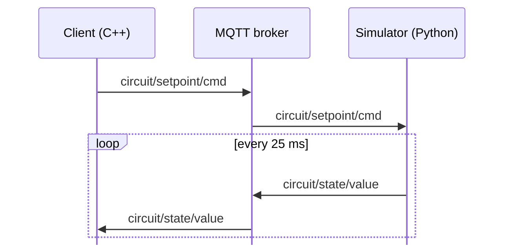

# MQTTSim

A small closed-loop simulation framework for testing embedded control software without physical hardware. A C++ client sends voltage setpoints over MQTT to a Python simulator, which models a series RLC circuit and sends the capacitor voltage back as feedback.

This repository accompanies the bachelor thesis *Simulation-Based Testing Framework for Embedded Systems Using MQTT and Cross-Compiled Code* (University of Stavanger / ABB Bryne, 2026).

## How it works



1. The **client** publishes an input voltage `Vin` (the setpoint).
2. The **broker** routes the message to the simulator.
3. The **simulator** integrates the circuit equations every 1 ms and publishes the capacitor voltage `Vout` every 25 ms.
4. The client receives `Vout` as feedback, the same signal the controller would read from its analog input on real hardware.

### The simulated plant

The simulator models the series RLC circuit used in the thesis's physical test setup:

| Component | Value |
|-----------|-------|
| Resistor R | 3 kΩ |
| Inductor L | 2 H |
| Capacitor C | 1000 µF |

These values give a heavily overdamped system (damping ratio ζ ≈ 33.5) with a dominant time constant of 3 s. After a step input, `Vout` rises smoothly without overshoot and settles in roughly 12 s.

## Message format

All messages are JSON and use QoS 1 (at least once delivery).

**`circuit/setpoint/cmd`**: client to simulator. The client publishes it with the retain flag, so a simulator that starts later still gets the latest setpoint.

```json
{ "setpoint": 5.0 }
```

**`circuit/state/value`**: simulator to client.

```json
{ "time": 12.35, "value": 4.6712, "setpoint": 5.0 }
```

`time` is simulation time in seconds, `value` is `Vout` in volts, and `setpoint` is the `Vin` currently applied.

## Getting started

### Prerequisites

- **An MQTT broker** listening on `localhost:1883`. [Mosquitto](https://mosquitto.org) is the simplest choice.
- **Python 3.9+** for the simulator.
- **CMake 3.15+**, a C++17 compiler, and [vcpkg](https://vcpkg.io) for the client.

### 1. Start the broker

```bash
# macOS
brew install mosquitto
mosquitto -v
```

On Windows, install Mosquitto from the official installer and run `mosquitto -v` from its install directory.

### 2. Run the simulator

```bash
cd simulator
python3 -m venv .venv
source .venv/bin/activate        # Windows: .venv\Scripts\activate
pip install -r requirements.txt
python3 simulator.py
```

The simulator runs until you press `Ctrl+C`. If the broker goes down, the simulation keeps running and reconnects automatically. While it is disconnected it stops publishing, and when it reconnects it publishes the current state rather than replaying old values.

### 3. Build and run the client

The client dependencies (Paho MQTT C/C++ and nlohmann-json) are declared in `client/vcpkg.json` and installed automatically during configure. `CMakeLists.txt` looks for vcpkg in `~/vcpkg` on macOS and `C:/vcpkg` on Windows. If yours is installed somewhere else, pass `-DCMAKE_TOOLCHAIN_FILE=<path>/scripts/buildsystems/vcpkg.cmake`.

```bash
cd client
cmake -B build -S .
cmake --build build
./build/mqtt_app
```

With no arguments, the client steps the setpoint through **0 V → 5 V → 10 V**, holding each value for 5 seconds. This matches the step test used on the physical hardware. To use your own sequence, pass the voltages as arguments:

```bash
./build/mqtt_app 0 2.5 7.5 -5
```

## Testing without the client

You can drive the simulator directly with the Mosquitto command-line tools:

```bash
# Watch the feedback
mosquitto_sub -t circuit/state/value

# In another terminal, apply a 5 V step
mosquitto_pub -t circuit/setpoint/cmd -q 1 -m '{"setpoint": 5.0}'
```

## Configuration

Settings are constants at the top of each source file.

| Setting | Where | Default |
|---------|-------|---------|
| Broker address | `HOST`/`PORT` in `simulator.py`, `kBroker` in `client.cpp` | `localhost:1883` |
| Circuit values | `R`, `L`, `C` in `simulator.py` | 3 kΩ, 2 H, 1000 µF |
| Integration step | `DT` in `simulator.py` | 1 ms |
| Publish interval | `PUBLISH_INTERVAL` in `simulator.py` | 25 ms |

## Project structure

```
MQTTSim/
├── client/                C++ MQTT client (setpoint publisher, feedback subscriber)
│   ├── src/client.cpp
│   ├── CMakeLists.txt
│   └── vcpkg.json
└── simulator/             Python RLC circuit simulator
    ├── simulator.py
    └── requirements.txt
```

## Scope and limitations

- **No shared memory bridge.** In the thesis, a C# proxy reads the Virtual IPS controller's analog output from Windows shared memory (`Apip04FpgaMemMap`). The C++ client here plays the proxy's MQTT role but sends setpoints itself instead of reading them from a controller.
- **Simplified model.** The RLC circuit has no noise, nonlinearities, or parasitic effects. Treat it as a proof of concept for the communication layer, not as a high-fidelity plant.
- **Single broker.** All communication goes through one broker, so it is a single point of failure.
